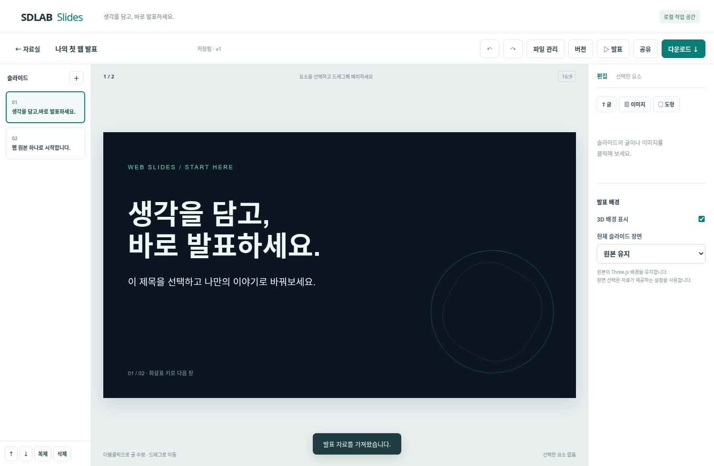
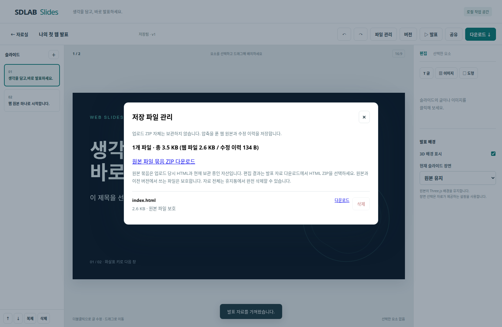

# Web Slides Studio

**HTML 발표 자료를 업로드하고, 브라우저에서 수정·발표·공유·다운로드하는 개인용 자료실입니다.**

매번 ZIP을 풀고 로컬 파일을 수정하는 대신, 웹 원본과 편집 이력을 한 서버에서 관리합니다. HTML·CSS·JavaScript·이미지·글꼴을 함께 보관하며, 로컬 자산으로 구성한 Three.js 발표 배경도 웹에서 실행할 수 있습니다.

이 저장소에는 애플리케이션 소스와 직접 만든 예제만 포함합니다. 운영 인스턴스 주소, 실제 비밀번호, 개인 발표 자료, 서버 데이터 및 운영 스크린샷은 포함하지 않습니다.

## 화면 예시

아래 화면은 저장소에 포함한 공개 예제로 생성했습니다.





## 주요 기능

| 기능 | 설명 |
| --- | --- |
| ZIP·폴더 등록 | `index.html`과 관련 자산을 읽어 발표 자료로 등록 |
| 자료실 | 제목·폴더 검색, 분류, 복제, 휴지통, 복원, 완전 삭제 |
| 웹 편집 | 글 수정, 이미지 추가·교체, 위치·크기·회전·글자색 변경, 글·도형 추가 |
| 슬라이드 관리 | 추가·복제·순서 변경·삭제, 실행 취소·다시 실행 |
| 저장 이력 | 서버 자동 저장, 충돌 안내, 이전 버전을 새 버전으로 복원 |
| 발표와 공유 | 비공개 미리보기, 특정 저장 버전 게시, 공유 종료 |
| 파일 관리 | 파일별 용량·다운로드, 웹 원본 묶음 ZIP, 사용하지 않는 추가 이미지 삭제 |
| 비밀번호 | 초기 암호로 로그인한 뒤 화면에서 변경, 변경 시 다른 세션 만료 |
| 출력 | HTML ZIP, 이미지 기반 PDF, 외형 보존 PPTX, 일부 요소 편집 가능 PPTX |

## 빠른 시작 — 로컬 PC

Node.js **22 LTS**와 npm, Chrome 또는 Chromium이 필요합니다. 소스는 Node.js 20 이상을 대상으로 작성했으며 운영 컨테이너는 Node.js 22 기반입니다. Chromium은 PDF/PPTX 출력과 브라우저 테스트에 사용합니다.

```sh
git clone https://github.com/no1fc/web-slides-studio.git
cd web-slides-studio
npm ci --ignore-scripts
npm start
```

관리 화면은 **http://127.0.0.1:4310**, 격리된 발표 콘텐츠는 **http://127.0.0.1:4311**을 사용합니다. 주소의 `127.0.0.1`을 `localhost`로 바꾸면 Host/origin 검사가 달라질 수 있으므로 그대로 접속합니다.

기본 실행은 loopback 전용이며 암호 없이 로컬에서 사용합니다. 외부 공개는 아래 배포 문서를 따라 HTTPS·초기 비밀번호·별도 콘텐츠 origin·렌더러 격리를 구성해야 합니다.

Chrome 경로가 기본값 `/usr/bin/google-chrome`과 다르면 지정하세요.

```sh
# Linux Chromium 예시
CHROME_PATH=/usr/bin/chromium npm start
# macOS Chrome 예시
CHROME_PATH='/Applications/Google Chrome.app/Contents/MacOS/Google Chrome' npm start
```

Windows PowerShell에서는 다음과 같이 환경변수를 지정할 수 있습니다.

```powershell
$env:CHROME_PATH = 'C:\Program Files\Google\Chrome\Application\chrome.exe'
npm start
```

Windows·macOS에서의 실제 실행은 별도 검증이 필요합니다. 현재 자동 검증 환경은 Linux Chrome/Chromium입니다.

**처음 사용한다면:** ‘자료 올리기 → 폴더 선택’에서 [`examples/basic-deck`](examples/basic-deck)을 선택하거나 해당 폴더를 ZIP으로 묶어 올리세요. 별도 외부 자산 없이 두 장의 예제 발표가 생성됩니다.

## 무엇이 서버에 저장되나요?

업로드한 **ZIP 파일 자체는 보관하지 않습니다.** 허용한 파일을 압축 해제하고 발표에 필요한 웹 파일과 편집 상태를 저장합니다. HTML에는 편집용 식별자가 추가되므로 최초 업로드 파일과 바이트 단위로 동일한 보관 서비스를 뜻하지 않습니다.

```text
data/
├── _auth.json                  # 암호 salt + scrypt 해시 (인증 사용 시)
└── <자료 UUID>/
    ├── meta.json               # 제목, 폴더, 공유 상태, 파일 정보
    ├── assets/                 # HTML, CSS, JS, 이미지, 글꼴 등
    └── revisions/
        ├── 1.json              # 최초 편집 상태
        └── 2.json              # 다음 저장 상태
```

- ‘파일 관리’에서 자산·이력·메타데이터를 포함한 자료별 사용량을 확인합니다.
- ‘원본 파일 묶음 ZIP’은 보관 중인 웹 파일을 요청 시 압축합니다. 인증정보·공유 토큰·수정 이력 파일은 포함하지 않습니다.
- 수정한 화면이 필요하면 편집기의 ‘다운로드 → 웹 발표 · HTML ZIP’을 사용합니다.
- 원본 파일과 **어느 저장 버전에서든 사용하는 파일**은 개별 삭제를 제한합니다. 이 기능 도입 전 업로드 파일도 안전하게 보호합니다.
- 이 기능 도입 후 추가한 이미지 중 원본·이력에서 참조하지 않는 파일은 확인 후 삭제할 수 있습니다.
- 자료 전체의 서버 파일과 이력은 ‘휴지통 → 완전 삭제’에서 제거합니다. 다운로드 파일을 생성하는 중에는 삭제할 수 없습니다.
- 이미 PC에 내려받은 파일과 외부 백업은 서버 삭제에 영향을 받지 않습니다.
- 출력 작업 결과는 서버 메모리에 잠시 보관하며 30분 후 만료합니다. 완전 삭제 시 해당 자료의 출력 캐시도 무효화됩니다.

## 지원하는 발표 형식

```text
my-deck/
├── index.html
├── style.css
├── app.js
└── assets/
    ├── image.png
    ├── font.woff2
    └── three.min.js
```

- 슬라이드는 `.slide` 요소 또는 같은 부모 아래의 `section` 요소로 인식합니다.
- 고정 **16:9 / 1920×1080** 발표를 우선 지원합니다.
- ZIP 최대 **40 MiB**, 해제 후 **64 MiB**, **300개 파일**, **80장**입니다. 추가 이미지도 해당 자료의 파일 수·자산 용량 제한에 포함됩니다.
- 지원 확장자는 HTML/CSS/JS, PNG/JPG/JPEG/WebP/GIF/SVG/ICO, WOFF/WOFF2/TTF/OTF, JSON, MP4/WebM입니다. PDF/PPTX는 업로드 편집 대상이 아닙니다.
- 외부 CDN·API·iframe 의존 자료는 그대로 동작하지 않을 수 있습니다. 라이브러리와 이미지·글꼴을 로컬 경로로 포함하세요.
- 임의 웹사이트나 모든 프레젠테이션 프레임워크를 자동 변환하지 않습니다. 가져온 자료의 레이아웃과 편집 가능한 요소를 먼저 확인하세요.

## 다운로드 형식의 차이

| 형식 | 유지되는 것 | 한계 |
| --- | --- | --- |
| HTML ZIP | 웹 화면·자산·지원 애니메이션·저장한 수정 | 압축 해제 후 사용. 원본이 fetch/ES module을 쓰면 로컬 HTTP 서버가 필요할 수 있음 |
| PDF | 슬라이드 외형, 여백 없는 16:9 | 이미지 기반이므로 글 검색·선택 불가, 애니메이션은 정지 화면 |
| PPTX 외형 보존 | 슬라이드 화면 전체 | 각 장이 한 이미지이므로 개별 문구 편집 불가 |
| PPTX 편집 가능 | 지원되는 글·이미지를 개별 요소로 분리 | CSS 장식·3D는 배경 이미지. 글꼴·줄바꿈 차이 가능 |

Three.js를 PPTX의 네이티브 3D 모델로 변환하는 기능은 없습니다. 편집 가능한 PPTX는 데스크톱 PowerPoint에서의 완전한 재현을 보장하지 않습니다.

## 로그인과 비밀번호 변경

로컬에서도 인증을 사용하려면 처음 실행할 때 `STUDIO_PASSWORD`를 지정합니다. 명령 이력에 암호를 직접 남기지 않으려면 `.env` 파일에 넣고 Node.js 환경 파일 옵션으로 실행하세요.

```sh
cp .env.example .env
# .env의 STUDIO_PASSWORD를 직접 입력
node --env-file=.env src/server.js
```

상단 **비밀번호 변경**에서 현재 비밀번호, 새 비밀번호, 확인값을 입력합니다. 새 암호는 현재와 다른 12~128자입니다. 저장에는 무작위 salt와 scrypt 해시를 사용하며 새 암호를 평문으로 보관하지 않습니다. 변경 후 현재 창은 새 세션으로 유지하고 다른 세션은 만료합니다.

`STUDIO_PASSWORD`는 **인증 파일이 없는 최초 실행에만** 사용합니다. `_auth.json`이 생긴 뒤에는 환경변수 값을 바꿔도 현재 암호를 덮어쓰지 않습니다. 암호를 잊었을 때의 서버 관리자 복구 절차는 [운영 문서](docs/OPERATIONS.md)를 확인하세요. 암호를 GitHub 이슈나 로그에 붙여 넣지 마세요.

## 개발과 검증

```sh
npm test
npm run test:e2e
```

테스트는 임시 디렉터리에 자체 생성 자료를 사용합니다. 개인 발표 파일이나 실제 운영 계정이 필요하지 않습니다. Chromium 경로를 `CHROME_PATH`로 지정할 수 있습니다.

검증 범위에는 경로 탈출·ZIP 크기 제한·중복 경로, Origin/인증, 저장 충돌, 공유 철회, 출력 일관성, 휴지통 삭제, 파일 보호, 암호 변경·세션 무효화·재시작 후 지속성이 포함됩니다. 실제 사용자 서버의 방화벽·백업·데스크톱 PowerPoint 호환성을 대신 검증하지는 않습니다.

## 구성과 문서

- [사용 안내](docs/USER_GUIDE.md): 등록부터 편집·발표·파일 정리까지
- [운영·설치 안내](docs/OPERATIONS.md): 환경변수, Docker, HTTPS, 백업, 암호 복구
- [구조·API](docs/ARCHITECTURE.md): 서버, 저장소, 편집·출력 흐름
- [보안 범위](SECURITY.md): 신뢰 경계와 보안 제보
- [변경 이력](CHANGELOG.md)

단일 관리자·단일 Node 프로세스를 위한 도구입니다. 실시간 공동 편집, 여러 replica, 임의 3D 장면 시각 편집, 내장 AI 생성 API, 정기 백업 자동화는 포함하지 않습니다.

## 라이선스

이 프로젝트 소스는 [MIT License](LICENSE)로 공개합니다. 포함된 예제도 같은 라이선스로 사용할 수 있습니다. 업로드하는 자료·글꼴·이미지·라이브러리의 권리는 각각의 권리자에게 있으며, 이 프로젝트의 MIT 라이선스가 그 권리를 대신하지 않습니다. 의존 패키지의 라이선스도 각각 적용됩니다.
