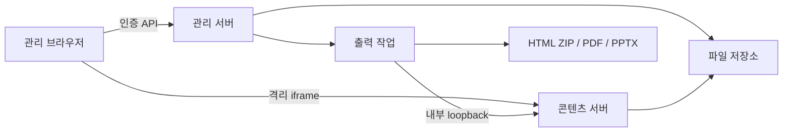

# 구조와 API

## 전체 흐름

관리 서버와 콘텐츠 서버는 같은 Node 프로세스의 서로 다른 포트에서 실행합니다. 브라우저에는 서로 다른 origin으로 노출합니다. 단일 관리자·단일 프로세스를 전제로 파일별 원자적 교체와 자료별 잠금을 사용합니다. 외부 DB는 필요하지 않습니다.

## 모듈

| 경로 | 책임 |
| --- | --- |
| `src/archive.js` | ZIP 원시 디렉터리·중복·경로·크기 검사, 허용 자산 수집 |
| `src/deck.js` | DOM 식별자, 편집 상태 검증, 원본에 수정 적용 |
| `src/store.js` | 메타데이터·불변 revision·공유·복제·잠금 |
| `src/auth.js` | 암호 해시 저장, 검증, 인증 변경 직렬화 |
| `src/files.js` | 자산 열거·용량·참조 조사·웹 원본 ZIP |
| `src/server.js` | 인증·Origin/Host·API·콘텐츠·출력 작업 관리 |
| `src/export.js` | Chromium 캡처, HTML/PDF/PPTX 생성 |
| `public/app.js` | 자료실·편집 UI·자동 저장·파일 관리·암호 변경 |
| `public/bridge.js` | 콘텐츠 iframe의 선택·이동·발표·출력 연결 |

## 편집과 revision

원본 HTML·자산을 유지하고 텍스트·이미지·배치·슬라이드 순서 등을 JSON 상태로 저장합니다. 각 저장 요청은 기준 revision을 포함합니다. 서버의 최신 revision과 다르면 409를 반환하며 자동으로 덮어쓰지 않습니다.

복원은 선택한 과거 상태를 현재 기준 revision 위에 새 버전으로 저장합니다. 공유 링크는 게시한 revision에 고정되며 다시 게시할 때만 최신 내용으로 바뀝니다.

## 관리 API

인증을 켠 경우 세션 쿠키가 필요합니다. 쓰기 요청의 `Origin`은 관리 origin과 같아야 합니다. Host도 설정값과 비교합니다. 별도 API key나 공용 외부 클라이언트 API는 제공하지 않습니다.

| 메서드 / 경로 | 역할 |
| --- | --- |
| POST `/api/login` | `{password}`로 로그인 |
| GET `/api/session` | 인증 상태, local 모드 확인 |
| POST `/api/logout` | 현재 세션 종료 |
| POST `/api/password` | `{currentPassword,newPassword}` 변경, 세션 교체 |
| GET `/api/decks` | 활성·휴지통 자료 목록 |
| POST `/api/decks` | ZIP 본문으로 자료 생성 |
| POST `/api/new` | 빈 발표 생성 |
| GET `/api/decks/:id` | 자료와 현재 편집 상태 |
| PATCH `/api/decks/:id` | 제목·폴더·휴지통 상태 |
| DELETE `/api/decks/:id` | 휴지통 자료의 완전 삭제 |
| POST `/api/decks/:id/save` | `{revision,state}` 저장 |
| GET `/api/decks/:id/revisions` | 최근 최대 100개 이력 목록 |
| POST `/api/decks/:id/restore` | `{revision,target}`로 복원 |
| POST `/api/decks/:id/duplicate` | 독립 사본 생성 |
| POST `/api/decks/:id/publish` | `{enabled}` 공유·철회 |
| POST `/api/decks/:id/assets?name=x.png` | 추가 이미지 본문 업로드 |
| GET `/api/decks/:id/files` | 파일별 크기·삭제 가능 여부·합계 |
| GET `/api/decks/:id/files?path=...` | 파일 첨부 다운로드 |
| DELETE `/api/decks/:id/files` | `{path}` 미사용 추가 이미지 삭제 |
| GET `/api/decks/:id/source` | 보관 웹 파일 묶음 ZIP |
| POST `/api/decks/:id/export` | `{revision,format}` 출력 작업 생성 |
| GET `/api/jobs/:jobId` | 출력 진행 상태 |
| GET `/api/jobs/:jobId/download` | 완료한 출력 다운로드 |

파일 다운로드는 관리자 origin에서 HTML을 실행하지 않도록 attachment와 이진 콘텐츠 유형으로 제공합니다. 원본 ZIP이나 메타데이터를 직접 정적 경로에 노출하지 않습니다.

## 콘텐츠·출력 경계

콘텐츠 서버는 자료 ID와 임의 토큰을 확인합니다. 비공개 미리보기와 공개 게시용 토큰을 구분합니다. 휴지통 자료와 철회된 링크는 읽을 수 없습니다. iframe·CSP·postMessage 출처 검사를 통해 관리 기능을 분리합니다.

출력기는 서버 내부 loopback 콘텐츠 URL을 읽습니다. 외부 HTTP 통신을 차단한 컨테이너에서도 동작하며, HTML/PDF/PPTX는 요청 당시의 저장 상태를 사용합니다. PDF와 외형 보존 PPTX는 슬라이드 캡처이고, 편집 가능 PPTX는 지원 요소를 별도로 추출합니다.

## 파일 삭제의 보호 범위

원본·이전 업로드 파일은 기본적으로 보호합니다. 이후 API로 추가한 이미지는 meta에 기록하며, 모든 revision과 HTML/CSS/JS/JSON 텍스트에서 사용을 검사합니다. 참조가 없는 추가 이미지에 한해 삭제를 허용합니다. 임의 JavaScript의 동적 동작을 완전히 정적 분석하는 시스템은 아니므로 직접 파일 구조를 바꾸는 고급 사용자는 별도 백업을 권장합니다.

삭제·업로드·저장·복제·출력 접수는 자료별 잠금과 검사를 사용합니다. 삭제된 이미지를 늦게 저장하려는 요청은 거부하며, 사용 중인 이력을 자동으로 잘라내지 않습니다.
