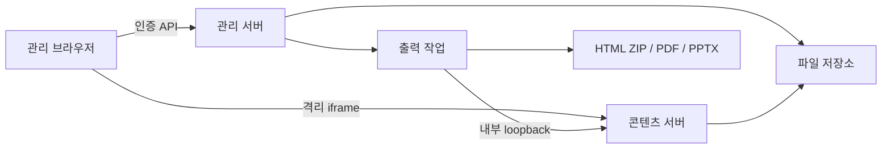

# 구조와 API

## 전체 흐름

관리 서버와 콘텐츠 서버는 같은 Node 프로세스의 서로 다른 포트에서 실행합니다. 브라우저에는 서로 다른 origin으로 노출합니다. 단일 관리자·단일 프로세스를 전제로 파일별 원자적 교체와 자료별 잠금을 사용합니다. 외부 DB는 필요하지 않습니다.

## 모듈

| 경로 | 책임 |
| --- | --- |
| `src/archive.js` | ZIP 원시 디렉터리·중복·경로·크기 검사, 허용 자산 수집 |
| `src/deck.js` | DOM 식별자, 편집 상태 검증, 원본에 수정 적용 |
| `src/authoring.js` | HTML/CSS 정규화, 코드 개체 ID, 마스터·코드 렌더링, 코드·복제 자산 참조 수집 |
| `src/store.js` | 메타데이터·불변 revision·공유·복제·잠금 |
| `src/auth.js` | 암호 해시 저장, 검증, 인증 변경 직렬화 |
| `src/files.js` | 자산 열거·용량·참조 조사·웹 원본 ZIP |
| `src/server.js` | 인증·Origin/Host·API·콘텐츠·출력 작업 관리 |
| `src/export.js` | Chromium 캡처, HTML/PDF/PPTX 생성 |
| `public/app.js` | 자료실·편집 UI·일괄 history·자동 저장·레이어·앱 내부 복사·파일 관리·암호 변경 |
| `public/authoring-ui.js` | HTML/CSS·JSON·마스터 편집창과 검증·초안 보존 |
| `public/bridge.js` | 콘텐츠 iframe의 DOM 선택·기하 계산·정밀 조작·배치·복제 스냅샷·발표·출력 연결 |

## 편집과 revision

원본 HTML·자산을 유지하고 텍스트·이미지·배치·슬라이드 순서 등을 JSON 상태로 저장합니다. 각 저장 요청은 기준 revision을 포함합니다. 서버의 최신 revision과 다르면 409를 반환하며 자동으로 덮어쓰지 않습니다.

복원은 선택한 과거 상태를 현재 기준 revision 위에 새 버전으로 저장합니다. 공유 링크는 게시한 revision에 고정되며 다시 게시할 때만 최신 내용으로 바뀝니다.

상태는 `schemaVersion: 1`을 사용합니다. 과거 상태를 읽을 때 빠진 코드·마스터 필드를 보완하며 과거 revision 파일을 덮어쓰지 않습니다. `slideCode`에는 슬라이드별 HTML/CSS, `masters`에는 공통 구성, `slideMasters`에는 연결을 저장합니다. `patches`에는 기존 위치·크기·내용에 더해 `locked`, `z`, `layerPosition`을 저장할 수 있으며, 독립 HTML 복제 개체는 `added`에 포함됩니다. 알 수 없는 필드와 지원하지 않는 버전은 거절합니다.

브라우저의 bridge는 실제 DOM의 선택과 좌표를 계산하고 일괄 변경을 부모 UI에 전달합니다. 부모는 명령 단위로 검증·history·저장을 처리합니다. 다중 조작 하나는 Undo 한 번에 대응하며, 드래그 취소는 선택 개체 전체를 되돌립니다. 복제·붙여넣기는 새 개체 ID와 독립 상태를 만들고 같은 자료 안의 앱 내부 복사 기능을 사용합니다.

레이어 순서는 같은 DOM 부모의 편집 개체 사이에 적용합니다. 다른 부모의 CSS stacking context를 평탄화하지 않습니다. `locked`는 편집 조작 보호이며 인증·접근 권한 제어가 아닙니다. 코드·JSON의 명시적 변경은 별도로 검증합니다.

## 관리 API

인증을 켠 경우 세션 쿠키가 필요합니다. 쓰기 요청의 `Origin`은 관리 origin과 같아야 합니다. Host도 설정값과 비교합니다. 별도 API key나 공용 외부 클라이언트 API는 제공하지 않습니다.

| 메서드 / 경로 | 역할 |
| --- | --- |
| POST `/api/login` | `{password}`로 로그인 |
| GET `/api/session` | 인증 상태, local 모드 확인 |
| POST `/api/logout` | 현재 세션 종료 |
| POST `/api/password` | `{currentPassword,newPassword}` 변경, 세션 교체 |
| GET `/api/decks` | 활성·휴지통 자료 목록 |
| POST `/api/decks` | ZIP 본문으로 자료 생성 |
| POST `/api/new` | 빈 발표 생성 |
| GET `/api/decks/:id` | 자료와 현재 편집 상태 |
| PATCH `/api/decks/:id` | 제목·폴더·휴지통 상태 |
| DELETE `/api/decks/:id` | 휴지통 자료의 완전 삭제 |
| POST `/api/decks/:id/save` | `{revision,state}` 저장 |
| GET `/api/decks/:id/authoring?slide=s0` | 현재 저장 상태의 슬라이드 편집 소스 `{slide,html,css}` 조회 |
| POST `/api/decks/:id/validate` | `{state}` 검증·정규화 후 `{state}` 반환. 저장하지 않음 |
| GET `/api/decks/:id/revisions` | 최근 최대 100개 이력 목록 |
| POST `/api/decks/:id/restore` | `{revision,target}`로 복원 |
| POST `/api/decks/:id/duplicate` | 독립 사본 생성 |
| POST `/api/decks/:id/publish` | `{enabled}` 공유·철회 |
| POST `/api/decks/:id/assets?name=x.png` | 추가 이미지 본문 업로드 |
| GET `/api/decks/:id/files` | 파일별 크기·삭제 가능 여부·합계 |
| GET `/api/decks/:id/files?path=...` | 파일 첨부 다운로드 |
| DELETE `/api/decks/:id/files` | `{path}` 미사용 추가 이미지 삭제 |
| GET `/api/decks/:id/source` | 보관 웹 파일 묶음 ZIP |
| POST `/api/decks/:id/export` | `{revision,format}` 출력 작업 생성 |
| GET `/api/jobs/:jobId` | 출력 진행 상태 |
| GET `/api/jobs/:jobId/download` | 완료한 출력 다운로드 |

파일 다운로드는 관리자 origin에서 HTML을 실행하지 않도록 attachment와 이진 콘텐츠 유형으로 제공합니다. 원본 ZIP이나 메타데이터를 직접 정적 경로에 노출하지 않습니다.

`authoring`은 저장된 슬라이드 코드가 있으면 해당 코드를, 없으면 원본 슬라이드 내부 HTML을 반환합니다. 빈 슬라이드는 빈 소스를 반환하며 복제 슬라이드의 편집 ID는 해당 슬라이드에 맞춥니다. 화면의 개체별 patch·추가 개체·마스터를 모두 합성한 최종 HTML 조회 API는 아닙니다.

`validate`는 인증·쓰기 Origin 검사를 거쳐 상태 구조와 HTML/CSS 허용 범위, 개체 ID·수치 등을 검증합니다. 파일을 쓰거나 revision을 증가시키지 않으며, 실제 자산 파일 존재 여부도 여기서 확인하지 않습니다. `save`는 기준 revision 충돌 검사와 상태 검증 뒤 이미지·코드·마스터·복제 HTML의 실제 자산 존재를 확인한 후 새 revision을 저장합니다. 따라서 검증 성공 후에도 누락 자산이나 동시 저장 때문에 저장이 실패할 수 있습니다.

## 콘텐츠·출력 경계

콘텐츠 서버는 자료 ID와 임의 토큰을 확인합니다. 비공개 미리보기와 공개 게시용 토큰을 구분합니다. 휴지통 자료와 철회된 링크는 읽을 수 없습니다. iframe·CSP·postMessage 출처 검사를 통해 관리 기능을 분리합니다.

출력기는 서버 내부 loopback 콘텐츠 URL을 읽습니다. 외부 HTTP 통신을 차단한 컨테이너에서도 동작하며, HTML/PDF/PPTX는 요청 당시의 저장 상태를 사용합니다. PDF와 외형 보존 PPTX는 슬라이드 캡처이고, 편집 가능 PPTX는 지원 요소를 별도로 추출합니다.

## 파일 삭제의 보호 범위

원본·이전 업로드 파일은 기본적으로 보호합니다. 이후 API로 추가한 이미지는 meta에 기록하며, 모든 revision과 HTML/CSS/JS/JSON 텍스트에서 사용을 검사합니다. 참조가 없는 추가 이미지에 한해 삭제를 허용합니다. 임의 JavaScript의 동적 동작을 완전히 정적 분석하는 시스템은 아니므로 직접 파일 구조를 바꾸는 고급 사용자는 별도 백업을 권장합니다.

삭제·업로드·저장·복제·출력 접수는 자료별 잠금과 검사를 사용합니다. 삭제된 이미지를 늦게 저장하려는 요청은 거부하며, 사용 중인 이력을 자동으로 잘라내지 않습니다.
