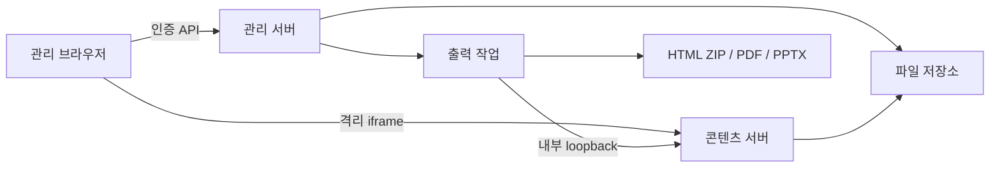

# 구조와 API

## 전체 흐름



관리 서버와 콘텐츠 서버는 같은 Node 프로세스의 서로 다른 포트에서 실행합니다. 브라우저에는 서로 다른 origin으로 노출합니다. 단일 관리자·단일 프로세스를 전제로 파일별 원자적 교체와 자료별 잠금을 사용합니다. 외부 DB는 필요하지 않습니다.

## 모듈

| 경로 | 책임 |
| --- | --- |
| `src/archive.js` | ZIP 원시 디렉터리·중복·경로·크기 검사, 허용 자산 수집 |
| `src/deck.js` | DOM 식별자, 편집 상태 검증, 원본에 수정 적용 |
| `src/authoring.js` | HTML/CSS 정규화, 코드 개체 ID, 마스터·코드 렌더링, 코드·복제 자산 참조 수집 |
| `src/store.js` | 메타데이터·불변 revision·공유·복제·잠금 |
| `src/auth.js` | 암호 해시 저장, 검증, 인증 변경 직렬화 |
| `src/files.js` | 자산 열거·용량·참조 조사·웹 원본 ZIP |
| `src/server.js` | 인증·Origin/Host·API·콘텐츠·출력 작업 관리 |
| `src/export.js` | Chromium 캡처, HTML/PDF/PPTX 생성, 오프라인 스크립트 포함 |
| `src/text-export.js` | richText의 PPTX run·문단 매핑, 표시 배율·목록·XML 문단 속성 보존 |
| `public/app.js` | 자료실·편집 UI·일괄 history·자동 저장·레이어·앱 내부 복사·파일 관리·암호 변경 |
| `public/authoring-ui.js` | HTML/CSS·JSON·마스터 편집창과 검증·초안 보존 |
| `public/bridge.js` | 콘텐츠 iframe의 DOM 선택·기하 계산·정밀 조작·배치·복제 스냅샷·발표·텍스트 명령·출력 연결 |
| `public/text-model.js` | 서버·브라우저 공용 richText/textBox 검증, 문자 범위 서식, 안전한 DOM 렌더링 |
| `public/text-editor.js` | 브라우저 DOM 읽기, 문자 선택 보존·복원, 실제 표시 자동 맞춤 |

## 편집과 revision

원본 HTML·자산을 유지하고 텍스트·이미지·배치·슬라이드 순서 등을 JSON 상태로 저장합니다. 각 저장 요청은 기준 revision을 포함합니다. 서버의 최신 revision과 다르면 409를 반환하며 자동으로 덮어쓰지 않습니다.

복원은 선택한 과거 상태를 현재 기준 revision 위에 새 버전으로 저장합니다. 공유 링크는 게시한 revision에 고정되며 다시 게시할 때만 최신 내용으로 바뀝니다.

상태는 `schemaVersion: 1`을 사용합니다. 과거 상태를 읽을 때 빠진 코드·마스터 필드를 보완하며 과거 revision 파일을 덮어쓰지 않습니다. `slideCode`에는 슬라이드별 HTML/CSS, `masters`에는 공통 구성, `slideMasters`에는 연결을 저장합니다. `patches`에는 기존 위치·크기·내용에 더해 `locked`, `z`, `layerPosition`, `richText`, `textBox`를 저장할 수 있으며, 독립 HTML 복제 개체는 `added`에 포함됩니다. 알 수 없는 필드와 지원하지 않는 버전은 거절합니다.

브라우저의 bridge는 실제 DOM의 선택과 좌표를 계산하고 일괄 변경을 부모 UI에 전달합니다. 부모는 명령 단위로 검증·history·저장을 처리합니다. 다중 조작 하나는 Undo 한 번에 대응하며, 드래그 취소는 선택 개체 전체를 되돌립니다. 복제·붙여넣기는 새 개체 ID와 독립 상태를 만들고 같은 자료 안의 앱 내부 복사 기능을 사용합니다.

레이어 순서는 같은 DOM 부모의 편집 개체 사이에 적용합니다. 다른 부모의 CSS stacking context를 평탄화하지 않습니다. `locked`는 편집 조작 보호이며 인증·접근 권한 제어가 아닙니다. 코드·JSON의 명시적 변경은 별도로 검증합니다.

## 구조화된 텍스트

`schemaVersion: 1`을 하위 호환 확장합니다. 기존 `text`만 있는 상태도 읽으며, 같은 개체에 `text`와 `richText`가 있으면 `richText`의 내용이 우선합니다. 새 서식은 `patches` 또는 `added` 개체에 저장합니다. 서버와 브라우저가 같은 classic script `public/text-model.js`의 `globalThis.SDText`를 사용합니다. Node는 이 파일을 side-effect import합니다.

다음은 JSON 편집 상태 안의 `patches.e0`에 넣는 예시입니다. 실제 문서에 존재하는 ID를 사용하고, 전체 상태의 `order`·`added`·코드·마스터 등 다른 필드는 유지합니다.

```json
{
  "richText": {
    "paragraphs": [
      {
        "runs": [
          { "text": "중요: ", "fontFamily": "Noto Sans KR", "fontSize": 40, "color": "#cc3300", "bold": true },
          { "text": "첫 항목", "fontSize": 32, "italic": true, "underline": true }
        ],
        "align": "left",
        "lineHeight": 1.5,
        "spaceAfter": 12,
        "indent": 1,
        "list": "bullet"
      },
      {
        "runs": [{ "text": "다음 문단", "fontSize": 32 }],
        "align": "justify",
        "lineHeight": 1.2,
        "spaceAfter": 0,
        "indent": 0,
        "list": "none"
      }
    ]
  },
  "textBox": { "vertical": "middle", "overflow": "clip", "autoFit": "shrink" }
}
```

문자 스타일은 선택 필드이며 생략하면 원본의 상속 스타일을 사용합니다. 크기는 6~400px, 색은 `#RRGGBB`, 글꼴 이름은 허용된 문자로 구성한 100자 이하 문자열, `bold`·`italic`·`underline`은 boolean입니다. 문단은 `align: left|center|right|justify`, `lineHeight: 0.5~4`, `spaceAfter: 0~200px`, `indent: 0~8` 정수, `list: none|bullet|number`를 받습니다. 들여쓰기 한 단계는 32px이고 목록 표식 영역은 24px입니다. 번호 카운터는 들여쓰기 깊이별로 관리하며 같은 깊이의 일반 문단·글머리표에서 재시작합니다.

`textBox`는 `vertical: top|middle|bottom`, `overflow: visible|clip`, `autoFit: none|shrink`를 지원합니다. 원래 크기·간격은 논리 문서 px로 저장합니다. 자동 축소의 `fontScale`은 표시 결과이며 저장 스키마에 넣지 않습니다. 브라우저는 글자·문단 뒤 간격·들여쓰기·목록 여백을 함께 축소하고 최소 표시 글자 크기 6px 아래로 줄이지 않습니다. 상자 크기는 유지하며, 맞지 않는 내용은 넘침 상태로 보고합니다.

richText 하나는 최대 500문단·5,000 run·100,000 UTF-16 단위의 문자(문단 사이 개행 포함)를 허용합니다. 전체 상태는 기존 직렬화 길이 2,000,000 제한을 유지합니다. unknown/inherited/accessor 필드와 비정상 배열을 거절하며 입력 문자열을 HTML로 해석하지 않습니다. DOM은 `[data-sd-text-content]` 아래 문단·run span의 `textContent`로 렌더링하며 목록 표식은 문자 선택 offset에서 제외합니다. 원본의 이미지·표·다른 편집 ID를 포함한 복합 컨테이너는 텍스트 도구 대상으로 변환하지 않습니다.

### 브라우저 명령과 저장

부모가 `commit-edit` 완료를 기다린 다음 `text-format {id,scope,changes}` 또는 `text-replace {id,text}`를 보냅니다. scope는 `character`, `paragraph`, `box`입니다. bridge는 대상 ID·슬라이드·편집 세션·잠금과 지원 여부를 다시 확인하고 `change {id,patch:{richText,text,textBox?}}`로 결과를 돌려줍니다. 부모는 기존 history·저장·revision 충돌 처리를 사용하므로 서식 명령 한 번이 Undo 한 번입니다.

문자 선택은 문단 사이 개행을 포함한 UTF-16 start/end 범위로 보관합니다. 문자 명령은 비어 있지 않은 선택 범위에 적용하고 커서만 있으면 전체 문자에 적용합니다. 문단 명령은 선택 범위가 걸친 문단, 또는 커서가 있는 문단에 적용하며 개체 선택만 있으면 모든 문단에 적용합니다. 상자 명령은 항상 개체 전체에 적용합니다. IME 조합 중 명령은 확정 뒤 실행하며, 직접 입력 중 외부 붙여넣기는 평문으로 처리합니다.

저장·재열기·개체 및 슬라이드 복제·버전 복원에는 동일한 모델이 사용됩니다. HTML/CSS·JSON·마스터와 기존 배치·레이어 상태도 같은 revision에 유지합니다. 과거 코드의 validator는 새 필드를 알지 못하므로 배포 롤백 시 코드와 데이터의 호환성을 함께 확인해야 합니다.

## 관리 API

인증을 켠 경우 세션 쿠키가 필요합니다. 쓰기 요청의 `Origin`은 관리 origin과 같아야 합니다. Host도 설정값과 비교합니다. 별도 API key나 공용 외부 클라이언트 API는 제공하지 않습니다.

| 메서드 / 경로 | 역할 |
| --- | --- |
| POST `/api/login` | `{password}`로 로그인 |
| GET `/api/session` | 인증 상태, local 모드 확인 |
| POST `/api/logout` | 현재 세션 종료 |
| POST `/api/password` | `{currentPassword,newPassword}` 변경, 세션 교체 |
| GET `/api/decks` | 활성·휴지통 자료 목록 |
| POST `/api/decks` | ZIP 본문으로 자료 생성 |
| POST `/api/new` | 빈 발표 생성 |
| GET `/api/decks/:id` | 자료와 현재 편집 상태 |
| PATCH `/api/decks/:id` | 제목·폴더·휴지통 상태 |
| DELETE `/api/decks/:id` | 휴지통 자료의 완전 삭제 |
| POST `/api/decks/:id/save` | `{revision,state}` 저장 |
| GET `/api/decks/:id/authoring?slide=s0` | 현재 저장 상태의 슬라이드 편집 소스 `{slide,html,css}` 조회 |
| POST `/api/decks/:id/validate` | `{state}` 검증·정규화 후 `{state}` 반환. 저장하지 않음 |
| GET `/api/decks/:id/revisions` | 최근 최대 100개 이력 목록 |
| POST `/api/decks/:id/restore` | `{revision,target}`로 복원 |
| POST `/api/decks/:id/duplicate` | 독립 사본 생성 |
| POST `/api/decks/:id/publish` | `{enabled}` 공유·철회 |
| POST `/api/decks/:id/assets?name=x.png` | 추가 이미지 본문 업로드 |
| GET `/api/decks/:id/files` | 파일별 크기·삭제 가능 여부·합계 |
| GET `/api/decks/:id/files?path=...` | 파일 첨부 다운로드 |
| DELETE `/api/decks/:id/files` | `{path}` 미사용 추가 이미지 삭제 |
| GET `/api/decks/:id/source` | 보관 웹 파일 묶음 ZIP |
| POST `/api/decks/:id/export` | `{revision,format}` 출력 작업 생성 |
| GET `/api/jobs/:jobId` | 출력 진행 상태 |
| GET `/api/jobs/:jobId/download` | 완료한 출력 다운로드 |

파일 다운로드는 관리자 origin에서 HTML을 실행하지 않도록 attachment와 이진 콘텐츠 유형으로 제공합니다. 원본 ZIP이나 메타데이터를 직접 정적 경로에 노출하지 않습니다.

`authoring`은 저장된 슬라이드 코드가 있으면 해당 코드를, 없으면 원본 슬라이드 내부 HTML을 반환합니다. 빈 슬라이드는 빈 소스를 반환하며 복제 슬라이드의 편집 ID는 해당 슬라이드에 맞춥니다. 화면의 개체별 patch·추가 개체·마스터를 모두 합성한 최종 HTML 조회 API는 아닙니다.

`validate`는 인증·쓰기 Origin 검사를 거쳐 상태 구조와 HTML/CSS 허용 범위, 개체 ID·수치 등을 검증합니다. 파일을 쓰거나 revision을 증가시키지 않으며, 실제 자산 파일 존재 여부도 여기서 확인하지 않습니다. `save`는 기준 revision 충돌 검사와 상태 검증 뒤 이미지·코드·마스터·복제 HTML의 실제 자산 존재를 확인한 후 새 revision을 저장합니다. 따라서 검증 성공 후에도 누락 자산이나 동시 저장 때문에 저장이 실패할 수 있습니다.

## 콘텐츠·출력 경계

콘텐츠 서버는 자료 ID와 임의 토큰을 확인합니다. 비공개 미리보기와 공개 게시용 토큰을 구분합니다. 휴지통 자료와 철회된 링크는 읽을 수 없습니다. iframe·CSP·postMessage 출처 검사를 통해 관리 기능을 분리합니다.

출력기는 서버 내부 loopback 콘텐츠 URL을 읽습니다. 외부 HTTP 통신을 차단한 컨테이너에서도 동작하며, HTML/PDF/PPTX는 요청 당시의 저장 상태를 사용합니다. 콘텐츠 서버는 `/_studio/text-model.js` → `/_studio/text-editor.js` → `/_studio/object-model.js` → `/_studio/bridge.js` 순서로 classic script를 넣습니다. 출력기의 요청 허용 목록에는 해당 네 경로와 자료 자산의 GET만 포함합니다. HTML ZIP에는 `assets/studio-object-model.js`, `assets/studio-text-model.js`, `assets/studio-text-editor.js`, `assets/studio-viewer.js`를 포함합니다.

PDF와 외형 보존 PPTX는 슬라이드 캡처이고, 편집 가능 PPTX는 지원 요소를 별도로 추출합니다. `collect()`의 텍스트에는 기존 좌표 외에 richText·textBox·표시 fontScale·padding·textOverflowing이 들어갑니다. 저장한 문단·run 구조를 유지하면서 생략된 서식은 실제 DOM의 computed style로 보완해 출력합니다. PPTX는 표시 배율을 반영한 문자 크기·문단 뒤 간격·들여쓰기·목록 여백과 원래 상자·회전을 사용하며 PowerPoint의 추가 자동 축소를 걸지 않습니다. 1920×1080 문서를 13⅓×7.5인치 슬라이드로 옮기므로 CSS px는 0.5pt에 대응합니다.

`src/text-export.js`는 글꼴·크기·색·굵게·기울임·밑줄을 run으로, 정렬·줄간격·간격·들여쓰기·목록을 문단 속성으로 기록합니다. PptxGenJS 4.0.1의 중복 문단 속성 및 일반 문단 들여쓰기 문제를 생성한 native 텍스트 상자에 한정한 XML 보정으로 처리합니다. 문단 내부 개행은 soft break로 남기고 글꼴 이름을 XML 속성으로 escape합니다.

`overflow: clip`이고 실제로 넘치는 텍스트는 화면에 보이는 자르기를 보존하기 위해 배경 이미지로 남깁니다. 지원하지 않는 복합 HTML·CSS 장식·3D도 이미지에 포함됩니다. 자동 검증은 PPTX XML 모델 보존을 확인하며 실제 PowerPoint의 글꼴 대체·줄바꿈·렌더링 동등성을 보장하지 않습니다. Linux Chromium과 설치 글꼴의 결과는 배포 환경에서 별도로 확인합니다.

## 이미지·도형·그룹 모델

`public/object-model.js`의 `SDObjects`를 서버 검증/렌더링, 편집 iframe, 관리자 UI, 출력기가 공유한다. schemaVersion 1을 유지하며 추가 이미지에는 `image`, 도형에는 `shape`, `kind:"group"`에는 `group`을 사용한다. 기존 사각형의 `fill`과 이전 이미지는 기본값으로 호환한다.

이전 사각형에 text/richText/textBox를 입력한 자료는 읽을 때 배경색을 가진 text 개체로 변환한다. 원본 revision은 다시 쓰지 않는다. 글자 크기가 없던 이전 도형은 `inheritFontSize:true`로 원본 CSS의 크기 상속을 유지하며, 독립 복제/그룹화할 때는 측정한 글자 크기로 확정한다. 명시적인 새 shape 모델에 텍스트를 섞으면 표시 손실 대신 검증 오류를 반환한다.

```json
{
  "id": "a-example", "slide": "s0", "kind": "image",
  "src": "assets/example.png", "x": 100, "y": 200, "w": 640, "h": 360,
  "image": {"mode": "fit", "crop": {"left": 0.1, "top": 0, "right": 0.2, "bottom": 0}}
}
```

`src`는 자료 안의 실제 파일이어야 하며 절대/상위 경로, URL, 인코딩된 경로 탈출은 거부한다. crop은 원본 기준 비율로 저장하며 대향 합은 0.99 이하다. `imageLayout`이 원본 이미지 크기와 프레임 크기로 실제 표시 위치와 유효 crop을 계산한다. 프레임 DIV와 내부 overflow window/IMG는 표준 CSS로 렌더링하며 원본을 다시 인코딩하지 않는다.

도형 예시는 `shape:{type:"ellipse",fill:"#087e77",stroke:"#123456",strokeWidth:3,dash:"solid"}`이다. type은 rect/ellipse/line/arrow, fill은 6자리 색 또는 none, dash는 solid/dash/dot이다. 입력 SVG를 실행하지 않고 검증한 값으로 SVG를 생성한다.

그룹 예시는 `kind:"group",x:100,y:100,w:600,h:300,group:{width:600,height:300,children:[...]}`이다. children은 id/slide가 없는 text/image/shape/group 스냅샷이며 내부 좌표계를 쓴다. 최상위 그룹에만 data-sd-id가 있다. 재귀 깊이 4, 재귀 총 개체 500, 편집 상태 2MB를 적용한다. 그룹 바깥 크기는 내부 크기에 대해 균일 배율이어야 한다. 해제는 중심 회전과 배율을 자식에 적용하고 전체 후보 상태를 검증한 뒤 한 번에 저장한다. 글자 크기·문단 간격·테두리를 확대하고 native text의 `textMetricsScale`로 고정 목록/들여쓰기 간격을 유지한다. 범위를 넘으면 clamp하지 않고 전체 명령을 거부한다.

부모는 `object-structure` 메시지의 현재 자료/슬라이드/session, 정확한 선택 ID, 잠금, native 종류를 확인한다. 원본 제거·자식 추가·patch 정리·같은 부모의 z 순서 변경을 하나의 history 항목으로 기록한다. 그룹은 가장 앞에 있는 선택 개체의 위치에 삽입하고 해제한 자식은 그룹의 현재 위치에 연속 배치한다. 복잡한 HTML의 CSS stacking context는 이 모델에 흡수하지 않는다.

콘텐츠와 HTML ZIP에는 bridge.js보다 앞에 object-model.js를 추가한다. 관리자에도 text-model.js와 object-model.js를 제공한다. 이미지 load·프레임 크기 변경 시 표시를 갱신하며 그룹 크기 변경은 내부 좌표계에 균일 CSS scale을 적용한다.

`src/object-export.js`는 원본 이미지 바이트와 PPTX srcRect, 네이티브 도형을 생성한다. WebP는 자르지 않은 전체 원본을 PNG로 변환한다. 그룹은 변환한 자식을 독립 editable 개체로 출력하고 지원 불가 자식이 하나라도 있으면 그룹 전체를 배경에 남긴다. 원본 경로는 자료 root의 realpath 안인지 확인한 후 읽는다. 현재 혼합 배경/네이티브 요소의 모든 겹침 및 PowerPoint 그룹 계층 복원은 6단계 호환성 과제다.

수집한 상위 개체가 배경으로 남으면 그 영역과 겹치는 하위 개체도 배경으로 돌려 겹침 순서를 보존한다. 이 판단은 뒤에서 앞으로 전파하고 회전 경계·그룹 밖 자식도 포함한다. 범위 밖으로 표시되는 텍스트가 있으면 보수적으로 슬라이드 전체를 사용한다. 이때 편집 가능한 출력 개체 수가 줄어들 수 있다. 수집 범위 밖 임의 HTML/CSS 장식의 전체 겹침은 별도 호환성 범위다.

## 파일 삭제의 보호 범위

원본·이전 업로드 파일은 기본적으로 보호합니다. 이후 API로 추가한 이미지는 meta에 기록하며, 모든 revision과 HTML/CSS/JS/JSON 텍스트에서 사용을 검사합니다. 참조가 없는 추가 이미지에 한해 삭제를 허용합니다. 임의 JavaScript의 동적 동작을 완전히 정적 분석하는 시스템은 아니므로 직접 파일 구조를 바꾸는 고급 사용자는 별도 백업을 권장합니다.

삭제·업로드·저장·복제·출력 접수는 자료별 잠금과 검사를 사용합니다. 삭제된 이미지를 늦게 저장하려는 요청은 거부하며, 사용 중인 이력을 자동으로 잘라내지 않습니다.
